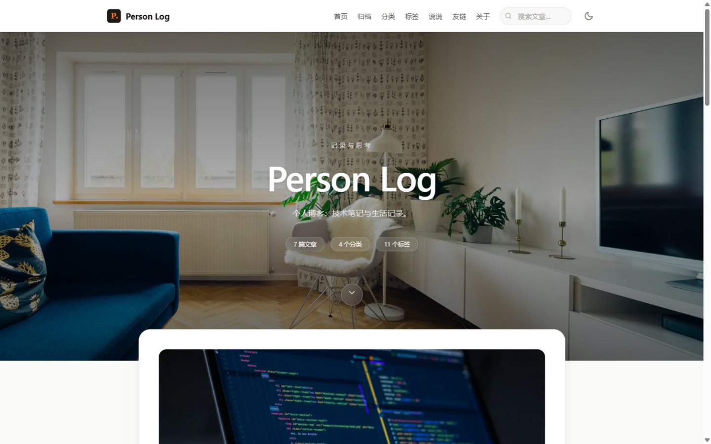
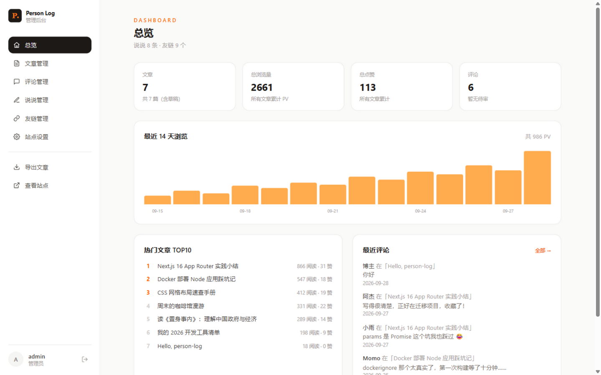

# Person Log · 个人博客

一个功能完整的个人博客系统：支持 Markdown 写作、评论互动、说说、友链、音乐库、相册、数据看板，图片自动优化，开箱即可本地运行，配套 Docker 部署方案。

     

| 前台 | 后台数据看板 |
| --- | --- |
|  |  |

## ✨ 功能特性

**前台**

- 🏠 照片横幅首页 + 浮层卡片布局，图片全站自动优化（AVIF/WebP、响应式、懒加载）
- 📝 Markdown 文章：GFM 语法、代码高亮、代码块复制、目录导航（TOC）、相关文章推荐
- 🗂 归档（时间线）、分类、标签、站内搜索（标题/摘要/全文）
- 🎵 音乐库：站内直接播放（持久播放条：播放/暂停/上下曲/进度拖动/音量/循环/随机，跨页不中断），专辑封面 + 星级评分 + 乐评，风格筛选与排序，黑胶唱片悬停动效
- 📷 相册：瀑布流 + 灯箱大图（键盘 ←/→/Esc、触摸滑动、拍摄地点与日期）
- 💬 评论系统：游客免注册评论、楼中楼回复、Cravatar 头像、先审后显 + 反垃圾（蜜罐/频率限制/关键词/耗时校验）
- 🌙 极光星夜深色主题（玻璃拟态、极光背景、星座动效）
- 🔗 文章分享（复制链接 / 微博 / X / 二维码）、OG/Twitter 分享卡片（优先使用文章封面）与 CC BY-NC-SA 4.0 版权声明
- 📡 RSS 订阅、邮箱订阅（含自助退订）、文章点赞、浏览量统计、JSON-LD 结构化数据（SEO）
- 📨 邮件通知（可选）：订阅需点击邮件确认后生效（防灌库）；博主回复评论时自动通知对方；新文章可一键推送给已确认订阅者；新评论待审时通知博主（未配置 SMTP 时自动跳过）

**后台**

- 📊 数据看板：总览卡片、最近 14 天 PV 趋势、热门文章 TOP10、最近评论
- ✍️ 文章管理：Markdown 编辑器（草稿/发布/置顶、自定义发布时间与定时发布、粘贴与拖拽上传配图、本地草稿暂存）、标题/slug/摘要搜索与状态筛选
- 🗂 分类标签管理：增删改、合并同类项（文章自动迁移到目标分类/标签）
- 💬 评论管理：审核/隐藏/恢复/删除、以博主身份回复
- ⚡ 说说管理、友链管理（增删改 + 显示隐藏）
- 📧 订阅管理：订阅者列表与确认状态、CSV 导出（仅已确认）、删除；访客可凭链接自助退订
- 🎵 音乐库管理（增删改 + 显示隐藏 + 封面/音频上传，音频支持 Range 拖动播放）、📷 相册管理（增删改 + 显示隐藏 + 照片上传，自动读取图片尺寸）
- ⚙️ 站点设置（站点名/SEO/页脚/横幅图/评论配置/ICP 备案号，保存即时生效；内置 SMTP 测试邮件）
- 🔐 账户安全（后台修改密码，改密后其他设备上的登录状态立即失效）
- 🖼 图片上传（本地磁盘图床，拒绝 SVG 防 XSS）
- 📦 内容导出：一键打包全部文章为 front-matter Markdown zip

## 🛠 技术栈

Next.js 16（App Router）· React 19 · TypeScript · Tailwind CSS 4 · Prisma ORM · MySQL 8 · jose（JWT 会话）· react-markdown + rehype

## 🚀 快速开始

前置：Node 20.9+、MySQL 8（本机安装或 Docker 均可）。

```bash
git clone https://github.com/xiaoqingxu271/person-log.git
cd person-log
cp .env.example .env    # 按需修改 DATABASE_URL / 管理员账号
npm install
npm run db:push         # 建表（prisma/schema.prisma 是唯一事实来源）
npm run db:seed         # 管理员账号 + 示例内容（幂等，可重复执行）
node prisma/seed-demo.mjs   # 可选：填充演示数据（文章/说说/友链/评论/PV 曲线）
node scripts/demo-aurora.mjs   # 可选：极光主题演示数据（文章/分类/标签/说说/友链）
node scripts/demo-life.mjs     # 可选：音乐库 + 相册演示数据（专辑/照片，幂等）
node scripts/generate-demo-audio.mjs  # 可选：合成原创演示音频（免版权 WAV，供站内试听）
npm run dev             # 访问 http://localhost:3000
```

- 前台：<http://localhost:3000>
- 后台：<http://localhost:3000/admin>，初始账号 `admin / admin123456`（**上线前务必修改**）
- 关于页内容：编辑 `content/about.md`

### 数据库准备

```sql
CREATE DATABASE personlog CHARACTER SET utf8mb4 COLLATE utf8mb4_unicode_ci;
CREATE USER 'personlog'@'localhost' IDENTIFIED BY 'personlog_pwd';
GRANT ALL PRIVILEGES ON personlog.* TO 'personlog'@'localhost';
```

## ⚙️ 环境变量

| 变量 | 说明 |
| --- | --- |
| `DATABASE_URL` | MySQL 连接串（本机 3306 或 Docker 映射的 3307） |
| `AUTH_SECRET` | 会话签名密钥，`openssl rand -hex 32` 生成 |
| `NEXT_PUBLIC_SITE_URL` | 站点对外地址（影响 RSS/sitemap/JSON-LD 中的链接）；设为 `https://` 域名后会话 Cookie 自动启用 Secure |
| `ADMIN_USERNAME` / `ADMIN_PASSWORD` | 初始管理员账号（seed 与容器首次启动使用；Docker 部署必填） |
| `SMTP_HOST` / `SMTP_PORT` | SMTP 服务器与端口（默认 587；465 自动启用隐式 TLS） |
| `SMTP_USER` / `SMTP_PASS` | SMTP 登录账号密码（无认证的内网中继可留空） |
| `SMTP_SECURE` | 是否隐式 TLS，留空按端口判断（465 为是） |
| `MAIL_FROM` | 发件人地址，留空回退为 `SMTP_USER`；同时作为待审评论通知的收件地址 |
| `MYSQL_ROOT_PASSWORD` / `MYSQL_PASSWORD` | Docker 部署必填的数据库密码；其余 `MYSQL_*` 见 docker-compose.yml |
| `APP_BIND_IP` / `APP_HOST_PORT` | Docker 应用监听地址与端口（默认仅绑定 127.0.0.1:3000） |

## 🧪 测试

服务器运行中（`npm run dev` 或 `npm run start`）执行：

```bash
npm run test:smoke   # 基础冒烟：登录/发布/评论/上传/导出/音乐库/相册/音频等 63 项
npm run test:e2e     # 定时发布/分类合并、订阅闭环/分享/确认、安全响应头，共 70 项
# 自定义地址
SMOKE_BASE=http://localhost:3001 npm run test:smoke
E2E_BASE=http://localhost:3001 npm run test:e2e
```

`.github/workflows/ci.yml` 在 push / PR 时自动启动 MySQL 服务，依次执行 lint、类型检查、构建、冒烟与 E2E 测试；另有独立任务校验 compose 配置并构建 Docker 镜像。

## 🐳 Docker 部署

```bash
cp .env.example .env
# 必填：AUTH_SECRET（openssl rand -hex 32）、MYSQL_ROOT_PASSWORD、MYSQL_PASSWORD、ADMIN_PASSWORD
docker compose up -d --build
```

- 首次启动自动建表，并在用户表为空时按 `ADMIN_USERNAME` / `ADMIN_PASSWORD` 创建管理员
- 想用 `http://服务器IP:3000` 直接预览时，把 `.env` 的 `APP_BIND_IP` 改为 `0.0.0.0`；正式上线保持 `127.0.0.1` 并走下面的反向代理
- MySQL 与应用默认只绑定 `127.0.0.1`，不会直接暴露公网
- `NEXT_PUBLIC_SITE_URL` 在构建期内联，改域名需重新 `docker compose up -d --build`
- 上传的图片与音频保存在 `uploads_data` 命名卷，重建镜像不丢；备份数据库之外请一并备份该卷
- `NEXT_PUBLIC_SITE_URL` / `AUTH_SECRET` / SMTP 变量均在 `.env` 中配置，compose 会自动注入
- 反向代理样例：`deploy/nginx.conf.example` 或 `deploy/Caddyfile.example`（HTTPS、40MB 上传上限、gzip）

MySQL 容器首次启动会自动执行 `docker/mysql/init/01-init.sql`（由 Prisma schema 生成）。

### 数据备份与恢复

备份脚本支持 Docker 部署与本机 `mysqldump` 两种方式，默认保留 14 天：

```bash
npm run backup
# 自定义目录与保留天数
BACKUP_DIR=/data/backups KEEP_DAYS=7 ./scripts/backup-db.sh
```

服务器上配置每日定时任务：

```bash
0 3 * * * cd /srv/person-log && ./scripts/backup-db.sh >> /var/log/person-log-backup.log 2>&1
```

恢复（示例）：

```bash
gunzip -c backups/person-log-YYYYmmdd-HHMMSS.sql.gz | docker compose exec -T mysql sh -c 'exec mysql -uroot -p"$MYSQL_ROOT_PASSWORD" "$MYSQL_DATABASE"'
```

## 🚢 上线检查清单

1. 域名购买 + 实名认证 + ICP 备案（部署在国内服务器时必办，周期约 1~3 周）
2. 服务器 `cp .env.example .env`：设置数据库强密码（`MYSQL_ROOT_PASSWORD` / `MYSQL_PASSWORD`）、`ADMIN_PASSWORD`、`AUTH_SECRET`，并把 `NEXT_PUBLIC_SITE_URL` 设为 `https://` 正式域名（会话 Cookie 会自动启用 Secure）
3. 签发 HTTPS 证书并配置反向代理（可直接套用 `deploy/` 下的 Nginx/Caddy 样例）；后台「账户安全」中修改默认管理员密码
4. 后台「站点设置」填写 ICP 备案号后提交 `sitemap.xml` 到搜索引擎
5. 配置每日备份定时任务（见「数据备份与恢复」）并做一次恢复演练

## 🧹 清空演示数据

```sql
SET FOREIGN_KEY_CHECKS = 0;
DELETE FROM comment; DELETE FROM post_tag; DELETE FROM post;
DELETE FROM moment; DELETE FROM friend_link; DELETE FROM daily_stat;
DELETE FROM category; DELETE FROM tag;
SET FOREIGN_KEY_CHECKS = 1;
```

## 🗑 清理上传孤儿文件

删除文章、替换封面或删除相册后，`data/uploads` 里可能残留不再被引用的文件。脚本会对比数据库与 `content/about.md` 中的 `/api/uploads` 引用，默认只预览：

```bash
npm run uploads:gc                      # 预览孤儿文件
npm run uploads:gc -- --delete          # 执行删除（默认跳过 24 小时内上传的文件）
node scripts/cleanup-uploads.mjs --dir=/path/to/uploads --min-age-hours=1
```

## 📁 目录结构

```
person-log/
├── prisma/
│   ├── schema.prisma        # 数据模型（唯一事实来源）
│   ├── seed.mjs             # 基础种子：管理员 + 示例文章
│   └── seed-demo.mjs        # 演示数据：文章/说说/友链/评论/PV 曲线
├── src/
│   ├── app/
│   │   ├── (site)/          # 前台：首页/文章/归档/分类/标签/说说/音乐/相册/友链/搜索/关于/隐私政策
│   │   ├── admin/           # 后台：看板/文章/分类标签/评论/说说/音乐/相册/友链/订阅/设置/账户安全
│   │   ├── api/             # REST 接口（文章/评论/上传/设置/导出/点赞/音乐/照片…）
│   │   ├── feed.xml         # RSS 订阅
│   │   ├── sitemap.ts / robots.ts
│   │   └── icon.svg         # 站点图标
│   ├── components/          # 前后台组件
│   └── lib/                 # 数据访问/会话认证/Markdown 渲染/统计
├── content/about.md         # 关于页内容（Markdown）
├── data/uploads/            # 上传图片（gitignore，注意备份）
├── scripts/backup-db.sh     # MySQL 备份脚本（Docker / 本机 mysqldump）
├── scripts/cleanup-uploads.mjs # 上传孤儿文件清理
├── scripts/e2e/             # 端到端测试（npm run test:e2e）
├── deploy/                  # 反向代理样例（Nginx / Caddy）
├── .github/workflows/ci.yml # CI：lint / 类型检查 / 构建 / 冒烟 / E2E
├── docker/                  # MySQL 初始化脚本
├── docker-compose.yml / Dockerfile
└── .smoke.mjs               # 冒烟测试脚本
```

## 📌 设计取舍

- 评论频率限制为进程内存版（单实例够用，多实例部署需换 Redis）；登录失败 5 次锁定 15 分钟同理
- Markdown 中的图片有意使用原生 `` 语义经 next/image 优化，未引入富文本编辑器
- 音乐库演示音频为脚本合成的原创氛围曲（免版权）；正式使用请上传你拥有授权的音频，无音频的专辑自动回退为外链收听
- 邮件通知需自备 SMTP（如 QQ 邮箱授权码、阿里云邮件推送、Resend SMTP）：未配置时订阅免确认直接生效、回复通知与群发自动跳过，不影响建站；配置后新订阅需点邮件确认，群发与 CSV 只包含已确认邮箱
- AI 摘要、外接统计（Umami）依赖外部服务，暂未集成

## 📄 License

[MIT](LICENSE)
