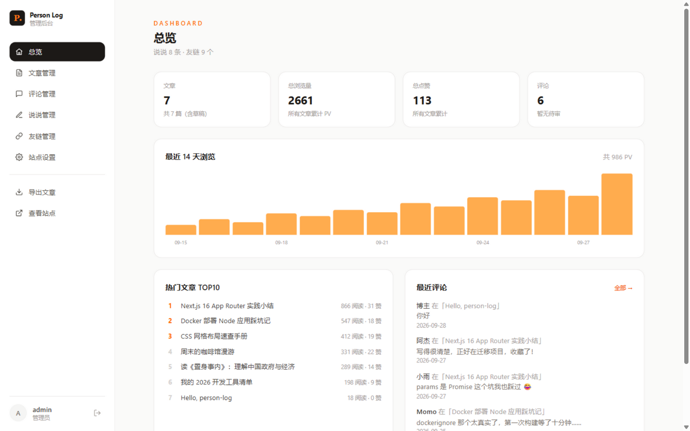

# Person Log · 个人博客

一个功能完整的个人博客系统：支持 Markdown 写作、评论互动、说说、友链、数据看板，图片自动优化，开箱即可本地运行，配套 Docker 部署方案。

    

| 前台 | 后台数据看板 |
| --- | --- |
|  |  |

## ✨ 功能特性

**前台**

- 🏠 照片横幅首页 + 浮层卡片布局，图片全站自动优化（AVIF/WebP、响应式、懒加载）
- 📝 Markdown 文章：GFM 语法、代码高亮、代码块复制、目录导航（TOC）、相关文章推荐
- 🗂 归档（时间线）、分类、标签、站内搜索（标题/摘要/全文）
- 💬 评论系统：游客免注册评论、楼中楼回复、Cravatar 头像、先审后显 + 反垃圾（蜜罐/频率限制/关键词/耗时校验）
- 🌙 暗色模式（跟随系统 + 手动切换，无闪烁）
- 📡 RSS 订阅、文章点赞、浏览量统计、JSON-LD 结构化数据（SEO）

**后台**

- 📊 数据看板：总览卡片、最近 14 天 PV 趋势、热门文章 TOP10、最近评论
- ✍️ 文章管理：Markdown 编辑器（草稿/发布/置顶、粘贴与拖拽上传配图、本地草稿暂存）
- 💬 评论管理：审核/隐藏/恢复/删除、以博主身份回复
- ⚡ 说说管理、友链管理（增删改 + 显示隐藏）
- ⚙️ 站点设置（站点名/SEO/页脚/横幅图/评论配置，保存即时生效）
- 🖼 图片上传（本地磁盘图床，拒绝 SVG 防 XSS）
- 📦 内容导出：一键打包全部文章为 front-matter Markdown zip

## 🛠 技术栈

Next.js 16（App Router）· React 19 · TypeScript · Tailwind CSS 4 · Prisma ORM · MySQL 8 · jose（JWT 会话）· react-markdown + rehype

## 🚀 快速开始

前置：Node 18+、MySQL 8（本机安装或 Docker 均可）。

```bash
git clone https://github.com/xiaoqingxu271/person-log.git
cd person-log
cp .env.example .env    # 按需修改 DATABASE_URL / 管理员账号
npm install
npm run db:push         # 建表（prisma/schema.prisma 是唯一事实来源）
npm run db:seed         # 管理员账号 + 示例内容（幂等，可重复执行）
node prisma/seed-demo.mjs   # 可选：填充演示数据（文章/说说/友链/评论/PV 曲线）
npm run dev             # 访问 http://localhost:3000
```

- 前台：<http://localhost:3000>
- 后台：<http://localhost:3000/admin>，初始账号 `admin / admin123456`（**上线前务必修改**）
- 关于页内容：编辑 `content/about.md`

### 数据库准备

```sql
CREATE DATABASE personlog CHARACTER SET utf8mb4 COLLATE utf8mb4_unicode_ci;
CREATE USER 'personlog'@'localhost' IDENTIFIED BY 'personlog_pwd';
GRANT ALL PRIVILEGES ON personlog.* TO 'personlog'@'localhost';
```

## ⚙️ 环境变量

| 变量 | 说明 |
| --- | --- |
| `DATABASE_URL` | MySQL 连接串（本机 3306 或 Docker 映射的 3307） |
| `AUTH_SECRET` | 会话签名密钥，`openssl rand -hex 32` 生成 |
| `NEXT_PUBLIC_SITE_URL` | 站点对外地址（影响 RSS/sitemap/JSON-LD 中的链接），上线时设为正式域名 |
| `ADMIN_USERNAME` / `ADMIN_PASSWORD` | 初始管理员账号（仅 seed 时使用） |
| `MYSQL_*` | 仅 Docker 部署时使用（见 docker-compose.yml） |

## 🧪 测试

服务器运行中（`npm run dev` 或 `npm run start`）执行全量冒烟测试（登录/发布/评论/上传/导出等 38 项）：

```bash
node .smoke.mjs
```

## 🐳 Docker 部署

```bash
cp .env.example .env   # 修改默认密码
docker compose up -d --build
```

MySQL 容器首次启动会自动执行 `docker/mysql/init/01-init.sql`（由 Prisma schema 生成）。

## 🚢 上线检查清单

1. 域名购买 + 实名认证 + ICP 备案（部署在国内服务器时必办，周期约 1~3 周）
2. 服务器 `cp .env.example .env`：修改数据库密码、`AUTH_SECRET`、`NEXT_PUBLIC_SITE_URL` 为正式域名
3. HTTPS 证书签发后，将 `src/app/api/auth/login/route.ts` 中会话 Cookie 的 `secure` 改为 `true`
4. 提交 `sitemap.xml` 到搜索引擎，页脚展示备案号
5. 配置备份：`docker exec person-log-mysql sh -c 'exec mysqldump -uroot -p"$MYSQL_ROOT_PASSWORD" "$MYSQL_DATABASE"' > backup.sql`

## 🧹 清空演示数据

```sql
SET FOREIGN_KEY_CHECKS = 0;
DELETE FROM comment; DELETE FROM post_tag; DELETE FROM post;
DELETE FROM moment; DELETE FROM friend_link; DELETE FROM daily_stat;
DELETE FROM category; DELETE FROM tag;
SET FOREIGN_KEY_CHECKS = 1;
```

## 📁 目录结构

```
person-log/
├── prisma/
│   ├── schema.prisma        # 数据模型（唯一事实来源）
│   ├── seed.mjs             # 基础种子：管理员 + 示例文章
│   └── seed-demo.mjs        # 演示数据：文章/说说/友链/评论/PV 曲线
├── src/
│   ├── app/
│   │   ├── (site)/          # 前台：首页/文章/归档/分类/标签/说说/友链/搜索/关于
│   │   ├── admin/           # 后台：看板/文章/评论/说说/友链/设置
│   │   ├── api/             # REST 接口（文章/评论/上传/设置/导出/点赞…）
│   │   ├── feed.xml         # RSS 订阅
│   │   ├── sitemap.ts / robots.ts
│   │   └── icon.svg         # 站点图标
│   ├── components/          # 前后台组件
│   └── lib/                 # 数据访问/会话认证/Markdown 渲染/统计
├── content/about.md         # 关于页内容（Markdown）
├── data/uploads/            # 上传图片（gitignore，注意备份）
├── docker/                  # MySQL 初始化脚本
├── docker-compose.yml / Dockerfile
└── .smoke.mjs               # 冒烟测试脚本
```

## 📌 设计取舍

- 评论频率限制为进程内存版（单实例够用，多实例部署需换 Redis）
- Markdown 中的图片有意使用原生 `` 语义经 next/image 优化，未引入富文本编辑器
- AI 摘要、评论邮件通知、外接统计（Umami）依赖外部服务，暂未集成

## 📄 License

[MIT](LICENSE)
